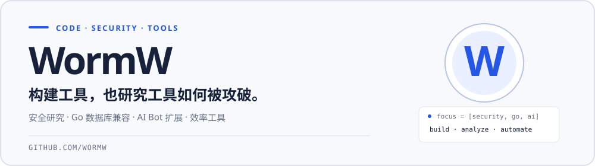

  

## 最近关注

| 安全研究 | 数据库兼容 | AI 与效率工具 |
| --- | --- | --- |
| 供应链事件分析、恶意代码逆向与防御检测。 | Go 驱动、协议差异与实际服务端兼容实践。 | 让 Bot 接入真实工作流，减少重复操作。 |

## 精选项目

| 项目 | 简介 | 技术 |
| --- | --- | --- |
| [**nikke_malware_analysis**](https://github.com/WormW/nikke_malware_analysis) | NIKKE Launcher 供应链事件与 K2F 样本的防御分析，附检测规则与 IOC。 | `Python` `YARA` |
| [**gbase8s-dolphin-go**](https://github.com/WormW/gbase8s-dolphin-go) | 面向 GBase 8s openGauss/dolphin MySQL 协议端口的 Go 连接示例与兼容层。 | `Go` `SQL` |
| [**nanobot-feishu-tools**](https://github.com/WormW/nanobot-feishu-tools) | 为 nanobot 提供飞书文档、知识库、多维表格和任务工具。 | `Python` `AI Tooling` |
| [**dev-nav**](https://github.com/WormW/dev-nav) | 零依赖个人开发导航页，支持搜索和自适应暗色模式。 | `HTML` `JavaScript` |

## 技术栈

  

## GitHub 数据

  
  

---

  <a href="mailto:i@acg.cx">i@acg.cx</a> · <a href="https://github.com/WormW">GitHub</a> 
  Thanks for stopping by.

